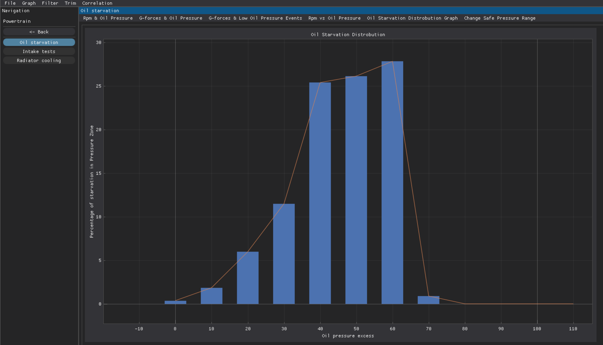
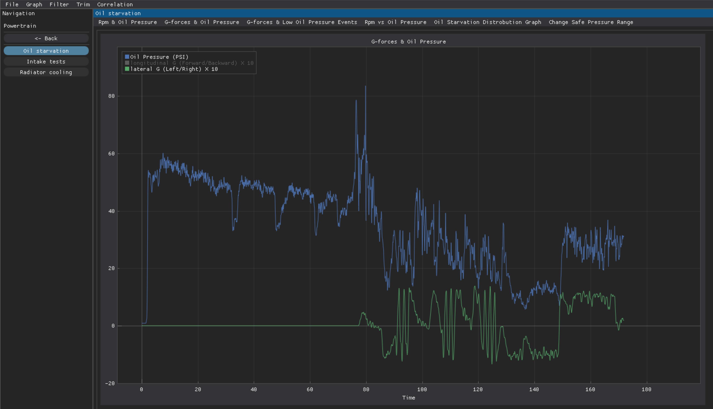
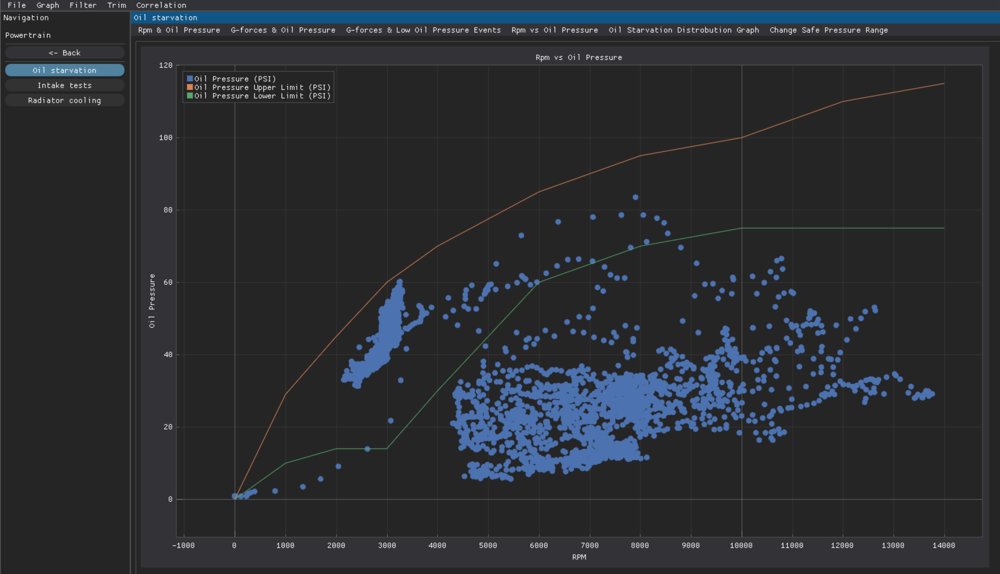
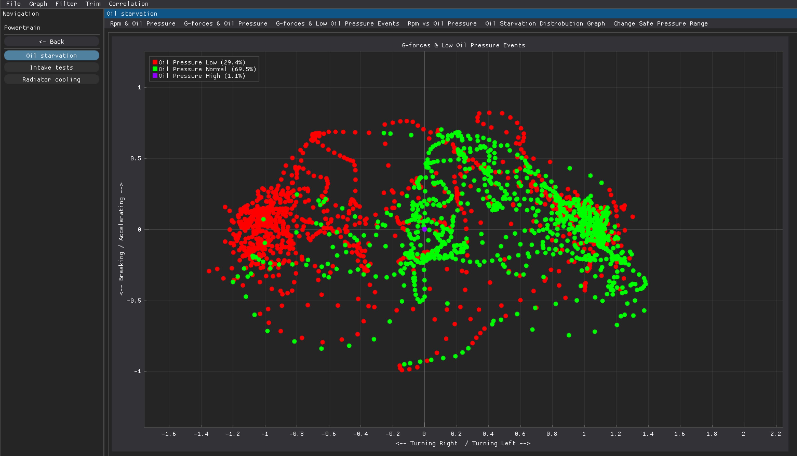
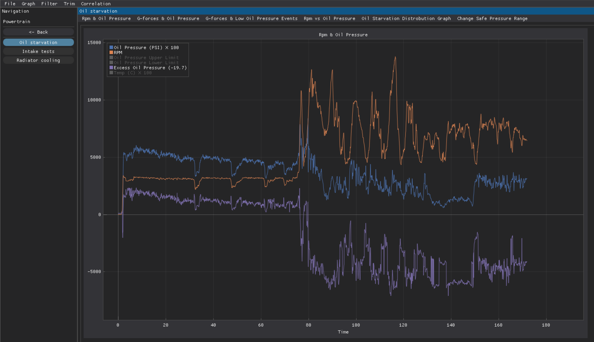

# Formula uOttawa's Data Analysis Tool
**What this project is**

This repository contains a custom analysis toolkit that connects to the team’s data sources to generate reusable plots, metrics, and reports tailored to FSAE needs. It is designed to be lightweight and easy for team members to run, modify, and extend as the car and sensors evolve over the season.

​
**Why build our own tools**

Off‑the‑shelf software that integrates with the ECU and dash (such as RaceStudio3) is powerful, but it hides much of the implementation and limits how deeply the team can experiment with custom analysis workflows. Building an in‑house toolkit aligns with the core FSAE goal of learning how systems work by designing and implementing them, rather than only configuring commercial solutions.

​
**Learning focus for new members**

This project is also a training ground for new software sub‑team members to learn modern software development practices in the context of real telemetry and performance questions. Contributors gain experience in data engineering, numerical analysis, and visualization while shipping tools that the rest of the team uses on a regular basis.
​

**Videos to get started**

[Race Telemetry for driver performance](https://youtu.be/lfqkhCCq5sg?si=wPToaZO_qaVD7nn6)

[Data Analysis in Racestudio3](https://youtu.be/IQTP2LN9oNg?si=Uc9kALhEnzJ77W5h)

[Formula SAE design competition format](https://www.youtube.com/watch?v=DqKXPHdX1aY)

**License**

Copyright (c) 2025 Formula uOttawa Contributors.

This project is licensed under the MIT License - see the [LICENSE](LICENSE) file for details.

 

## Setup
First, download and install the [Anaconda installer](https://www.anaconda.com/download), this will allow you to organize the libraries we use. Then, open Anaconda prompt (as administrator) and create the project environment from the provided spec file using:

`conda env create -f environment.yml`

This will automatically create the environment, set the correct Python version, and install all required libraries in one step. Once it finishes, activate the environment using:

`conda activate FSAEDataGUI`

Then, verify your dearpygui installation by running the following command:

`python -m dearpygui.demo`

You should see a demo program showing off some features. You can now install Git and your preferred integrated development environment (IDE) to contribute to the software! Make sure to set your environment to FSAEDataGUI in the IDE. You should also be familiar with using branches and making pull requests on Git, you can find many good tutorials on YouTube. We recommend using [GitHub Desktop](https://desktop.github.com/download/) and [VSCode](https://code.visualstudio.com/).

 

## Oil Starvation Analysis

The Oil Starvation tool helps our team analyze the oil-system behaviour during vehicle operation and identify any potential losses in oil pressure which causes a lack of lubrication inside the engine. A phenomenon known as oil starvation. It's important for motorsport because oil starvation results in worn cylinder walls, gasket damage, and eventually a blown engine. By Analiyzing oil pressure, oil temperature, engine RPM, and G-Forces, we can better understand how the engine's lubrication system performs under diffrent driving conditions and stress.

 

  
  
  
  
  

 

### **Key Features**

- **Oil Pressure Monitoring:** Visulizes oil pressure alongside engine RPM, oil temperature, and excess oil pressure.
- **G-Force Analysis:** Helps identify whether acceleration, braking, or cornering contributes to oil pressure starvation.
- **Severity Analysis:** Measures how far oil pressure falls outside its ideal range, helping the team evaluate the effectiveness of design improvements.
- **Customizable Thresholds:** Enables the team to adjust acceptable oil pressure ranges for different engine speeds.

### **Why It Matters**

During aggressive cornering, braking, and acceleration, engine oil can shift inside the oil pan, reducing the oil supply to critical engine components. Using RPM-dependent pressure thresholds, the system automatically identifies abnormal pressure readings and allows the team to investigate their frequency, duration, and severity. These findings can be compared with physical engine inspections, including checks for cylinder wall damage, bearing wear, and other signs of engine damage. By identifying when and under what conditions oil pressure drops occur, our team can investigate potential lubrication issues, evaluate design improvements, make data-driven decisions to improve engine reliability, and ultimately maximize vehicle performance on track.

 

